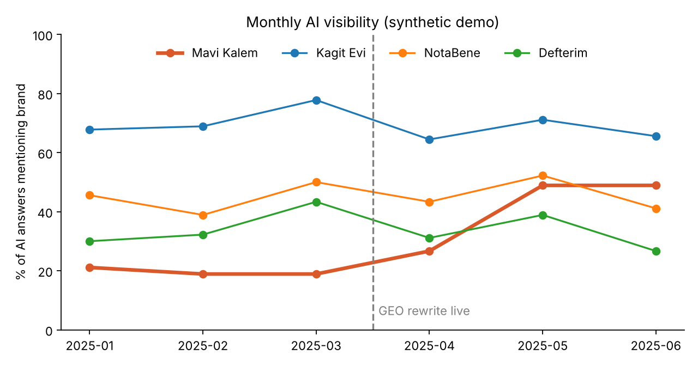

# Monthly AI-visibility tracking

**Service:** every month I query ChatGPT, Gemini and Perplexity with the same set of buyer questions and report how often your brand is mentioned, your share of voice against competitors and what changed.



**Demo result (synthetic, fictional brands):** after a GEO content rewrite in month 4, the client's mention rate rises from **21% to 49%** and it moves to **2nd of 4** brands. See [`REPORT.md`](REPORT.md).

| File | What it is |
|---|---|
| `tracker.py` | Log → monthly metrics → report and chart |
| `demo_log.csv` | 540 synthetic AI answers (30 prompts × 3 engines × 6 months) |
| `monthly_summary.csv` | Mention rate, share of voice, month-on-month change |
| `test_tracker.py` | Checks rates and share of voice on a hand-calculated example |

```bash
python tracker.py
pytest -q
```

> Numbers here are simulated to show the deliverable. Real tracking uses live, scheduled queries; AI answers vary between runs, so each prompt is asked several times and results are reported as rates.
