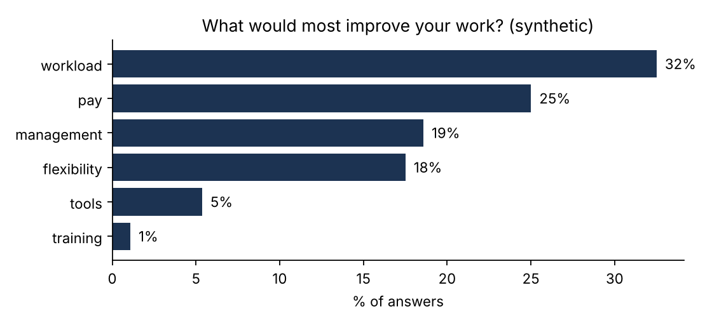

# AI-assisted coding of open-ended survey answers

**Service:** you have hundreds or thousands of free-text answers. I build a codebook, hand-code a sample, train a classifier on it, code the rest, and flag the uncertain answers for human review, so you get themes you can trust in days, not weeks.



**Demo** (400 synthetic answers to "What one thing would most improve your work?", 6 themes, about 30% of answers mention two themes):

| | Result |
|---|---|
| Human-coded training sample | 120 answers |
| AI-coded | 280 answers |
| Agreement with held-out human codes | **81%, Cohen's κ = 0.76** |
| Answers flagged for review (confidence < 0.5) | 68 |
| Accuracy on the answers *not* flagged | **90%** |

The point is not to replace the human coder: the model does the clear cases, and human time goes to the ambiguous ones (usually answers that mention two themes).

```bash
python code_responses.py    # writes coded_answers.csv, themes.png, REPORT.md
pytest -q
```

For projects that need it, the same workflow runs with an LLM as the coder. The human-coded sample and κ check stay the same, so the quality is measured, not assumed.
