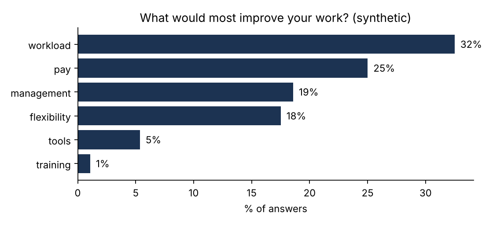

# Open-ended coding report (demo)

- Human-coded training sample: **120** answers; AI-coded: **280**
- Agreement with held-out human codes: **81%**, Cohen's κ = **0.76**
- Flagged for human review (confidence < 0.5): **68**

*Synthetic answers.*