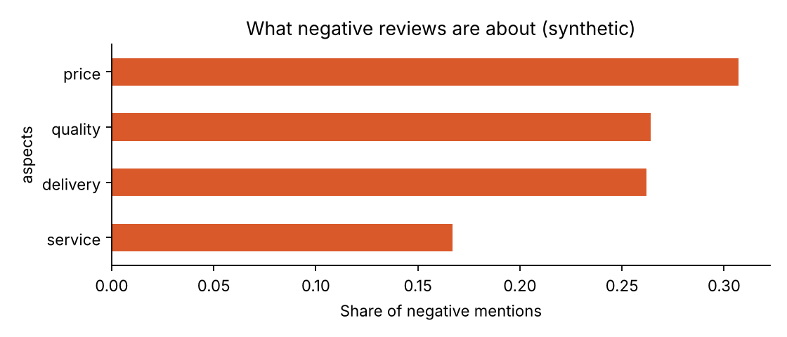

# Customer review sentiment and aspect analysis

**Service:** I turn a pile of reviews (marketplace, app store, Google, survey comments) into a clear answer: how positive customers are, and **what exactly** the negative ones complain about.



**Demo** (1,200 synthetic reviews for a fictional home-goods shop, with mixed reviews and about 8% noisy labels, as in real data):

| Metric (held-out 30%) | Value |
|---|---|
| Accuracy | **91%** |
| Macro F1 | 0.89 |
| Hardest class | neutral (recall 0.82) |
| Top complaint | **price** (31% of negative mentions) |

Full output: [`REPORT.md`](REPORT.md) and [`scored_reviews.csv`](scored_reviews.csv).

**How:** TF-IDF + logistic regression trained on labelled reviews, checked on reviews it never saw. Aspects (price, delivery, quality, service) are tagged with a transparent keyword list the client can edit. For short projects I can instead use an LLM with the same evaluation step, so accuracy is still measured, not assumed.

```bash
python sentiment.py
pytest -q
```
