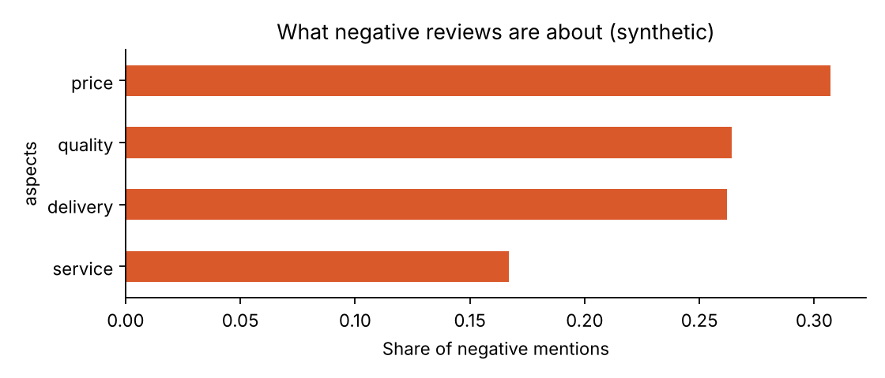

# Review sentiment report (demo)

Held-out accuracy: **91%** (n = 360), macro F1 = **0.89**

| Class | Precision | Recall |
|---|---|---|
| positive | 0.93 | 0.94 |
| negative | 0.87 | 0.90 |
| neutral | 0.91 | 0.82 |

Top complaint: **price** (31% of negative aspect mentions).

*Synthetic reviews for a fictional shop.*