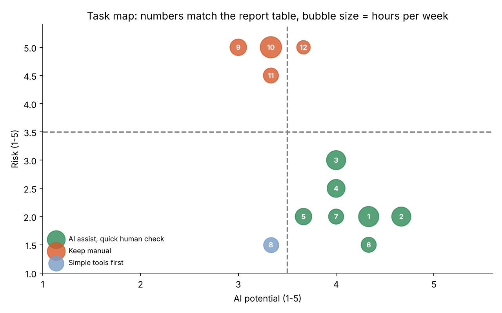

# AI workflow audit: where can AI save your team time, safely?

**Service:** I interview your team, list the recurring tasks, and score each one for **AI potential** (repetitive, text-heavy, rule-based) and **risk** (data sensitivity, cost of an error). You get a prioritised plan: what to hand to AI, what AI should only draft, what needs a simple template instead, and what should stay manual.



**Demo** (a fictional 15-person NGO, 12 tasks): estimated **17.4 hours saved per week**, about half a full-time post over a year. See [`REPORT.md`](REPORT.md).

| Recommendation | Examples from the demo |
|---|---|
| AI assist, quick human check | meeting notes, routine donor emails, activity report drafts, translation drafts |
| Simple tools first | social media drafts (a content calendar and templates come first) |
| Keep manual | payroll, budget checks, case notes on vulnerable families, beneficiary database cleaning |

Saving rates are deliberately conservative (50% for low-risk AI assist, 25% where a human must approve each output). High-risk work involving personal data stays manual unless there is a proper data-protection review.

```bash
python audit.py
pytest -q
```

Inputs come from a 30-minute interview per team, using the columns in [`tasks.csv`](tasks.csv).
