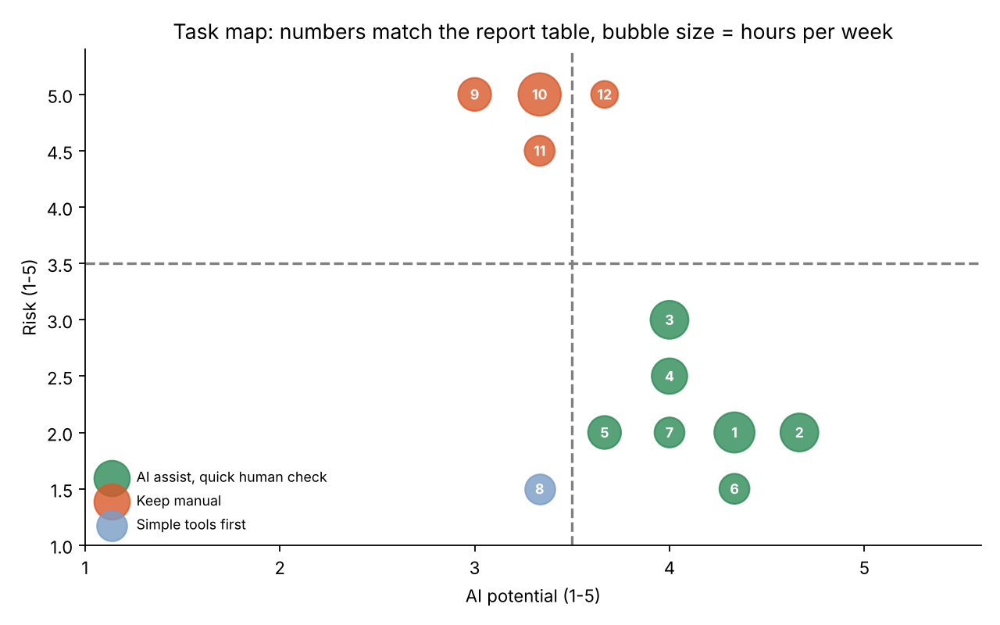

# AI workflow audit (demo: fictional 15-person NGO)

Estimated time saved: **17.4 hours per week** (about 0.5 of a full-time post over a year).

| # | Task | Hours/week | Recommendation | Hours saved/week |
|---|---|---|---|---|
| 1 | Meeting notes and action lists | 7 | AI assist, quick human check | 3.5 |
| 2 | Answering routine donor emails | 6 | AI assist, quick human check | 3.0 |
| 3 | Entering survey data into Excel | 6 | AI assist, quick human check | 3.0 |
| 4 | Writing monthly activity reports | 5 | AI assist, quick human check | 2.5 |
| 5 | Translating materials EN-TR | 4 | AI assist, quick human check | 2.0 |
| 6 | Screening grant calls for fit | 3 | AI assist, quick human check | 1.5 |
| 7 | Scheduling volunteers | 3 | AI assist, quick human check | 1.5 |
| 8 | Social media post drafts | 3 | Simple tools first | 0.4 |
| 9 | Cleaning beneficiary database | 4 | Keep manual | 0.0 |
| 10 | Case notes for vulnerable families | 8 | Keep manual | 0.0 |
| 11 | Budget variance checks | 3 | Keep manual | 0.0 |
| 12 | Payroll | 2 | Keep manual | 0.0 |

*Illustrative task inventory; saving rates are conservative assumptions.*