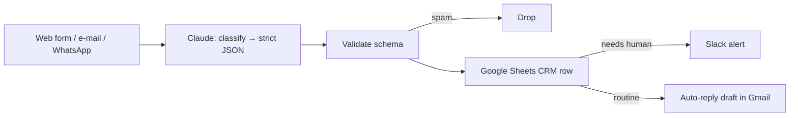

# AI Automation: Customer Message & Lead Triage

**Service:** AI automation · n8n / Make / Zapier workflows · Claude & ChatGPT integration · AI agents for small businesses

**Client problem:** "We get 100+ messages a day from the website, e-mail and WhatsApp. Important ones get lost, spam wastes time, and customers wait hours for a reply."

**Solution:** every message is classified by an LLM into **intent**, **urgency** and **language**; order numbers and names are extracted; a reply is drafted; urgent or B2B messages are escalated to a person.



## Two implementations
| | File | For |
|---|---|---|
| **n8n** (no-code) | [`n8n_workflow.json`](n8n_workflow.json) | *Import from file* in n8n, add credentials, done. 8 nodes. |
| **Python** | [`triage.py`](triage.py) | Custom integrations, batch processing. Uses Claude if `ANTHROPIC_API_KEY` is set, otherwise a rule-based fallback. |

## Production safeguards
- **Strict output schema**: invalid model output is coerced to safe defaults, never crashes the flow
- **Fallback path**: if the API fails, rules still triage, so no message is lost
- **Human in the loop**: complaints, B2B and high-urgency messages are always escalated; replies are saved as **drafts**, not sent blindly
- **No promises**: the prompt forbids the bot from promising refunds or delivery dates
- Bilingual (Turkish / English)

## Run it
```bash
python triage.py            # processes sample_inbox.jsonl → triaged.csv
pytest -q test_triage.py    # 6 tests
```
Sample result: 7 messages → 2 escalated (angry double-charge complaint, wholesale enquiry), 1 spam filtered, 4 auto-reply drafts.

**Typical client deliverables:** workflow set-up, prompt and schema design, test set, a 1-page runbook and a handover call.
