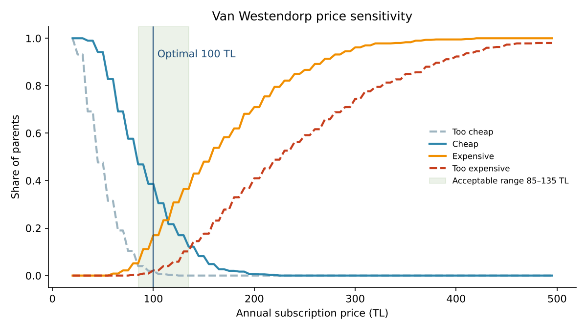

# Market Research: Pricing, Segmentation & Market Sizing

**Service:** market research · consumer surveys · pricing studies · customer segmentation · market sizing (TAM/SAM/SOM)

**Client question:** "We're launching a reading app for parents of young children. What should we charge, who buys first, and how big is the market?"

👉 **Read the client report: [`REPORT.md`](REPORT.md)**

| Method | Why it matters to the client |
|---|---|
| **Van Westendorp price sensitivity meter** | Acceptable price range and optimal price point, from four simple survey questions |
| **k-means segmentation** | 4 parent segments with size, purchase rate and willingness to pay: who to target first |
| **Driver analysis** (logistic regression) | Which product features actually move purchase intent, so marketing leads with the right message |
| **TAM / SAM / SOM** | Market size with every assumption visible and editable |



Deliverables I provide for real projects: questionnaire design (incl. Van Westendorp, MaxDiff, NPS), survey set-up (Google Forms / Typeform / Qualtrics), analysis, a client-ready report and slide summary, and a raw-data appendix.

```bash
pip install pandas scikit-learn matplotlib tabulate
python study.py
```
*Data is synthetic and the product is fictional; this is a methods showcase.*
