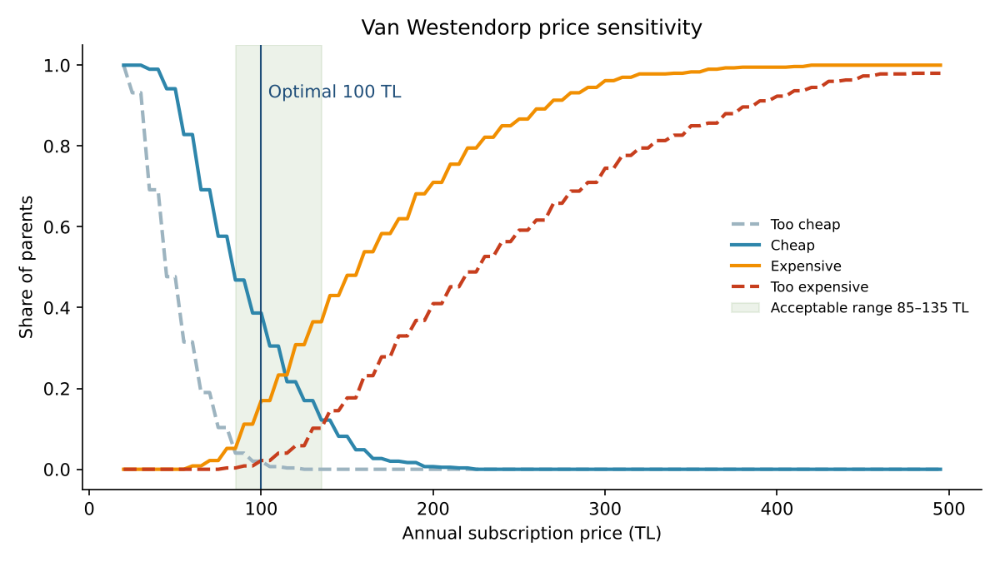
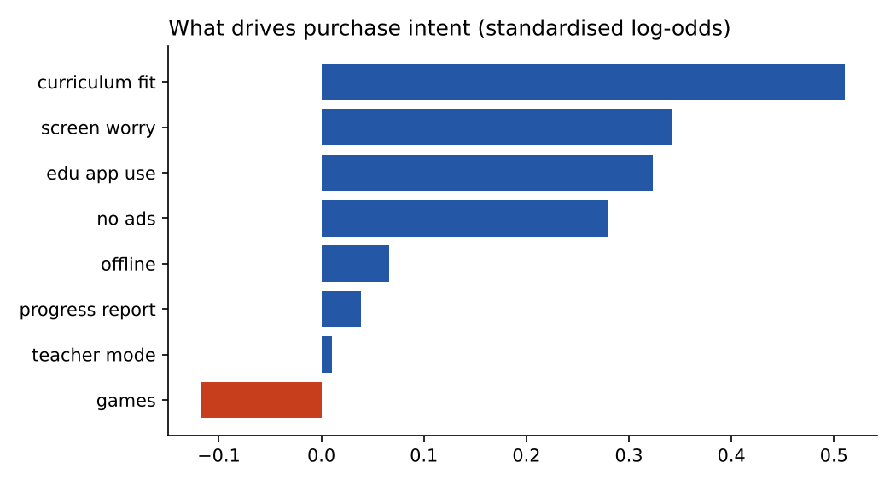

# Market Research Report: "Hece Hece" Reading App (illustrative)

**Question:** Will parents of 5–7-year-olds pay for a curriculum-aligned phonics app, at what price, and who should we target first?
**Method:** online survey, n = 600 parents (synthetic data for portfolio purposes); Van Westendorp price sensitivity meter; k-means segmentation on attitudes and feature ratings; logistic regression of purchase intent.

## Key findings
1. **Price:** acceptable range **85–135 TL/year**; optimal price point **100 TL**, indifference point 115 TL. Recommend launching at **109 TL/year** with a monthly option.
2. **44%** of parents say they would buy, rising to **59%** in the best segment.
3. **Strongest drivers** of intent: curriculum fit, screen worry, edu app use. Games rank 8 of 8: reassurance about the curriculum outweighs entertainment.

## Segments
| name                       |   share |   buy_rate |   curriculum |   no_ads |   games |   screen_worry |   median "expensive" price (TL) |
|:---------------------------|--------:|-----------:|-------------:|---------:|--------:|---------------:|--------------------------------:|
| App-savvy early adopters   |    0.25 |       0.59 |         4.57 |     4.14 |    3.31 |           3.97 |                             160 |
| Curriculum-driven planners |    0.28 |       0.49 |         4.63 |     4.06 |    3.04 |           3.23 |                             160 |
| Fun-first parents          |    0.26 |       0.37 |         4.47 |     3.71 |    4.11 |           2.08 |                             150 |
| Progress trackers          |    0.2  |       0.26 |         3.06 |     4.03 |    2.99 |           2.89 |                             170 |

**Target first:** *App-savvy early adopters*. Message: "aligned with the school curriculum, no ads, weekly progress report".

## Market size (year 1, editable assumptions)
| | Value | Assumption |
|---|---|---|
| TAM | 306M TL | 3,600,000 children aged 5–7 × 85% online parents × 100 TL |
| SAM | 199M TL | × 65% in target income band |
| SOM | 2.4M TL | × 1.2% year-1 adoption |

## Recommendations
- Lead with curriculum alignment and "no ads" in all messaging; test games as a secondary feature
- Annual plan near 100 TL plus a monthly plan; free trial of one sound group
- Launch in metropolitan areas through school-parent WhatsApp groups and teacher referrals

## Limitations
Synthetic illustrative data; stated intent overstates real purchase (apply a 30–50% haircut); child population figure must be refreshed from TÜİK before use.
