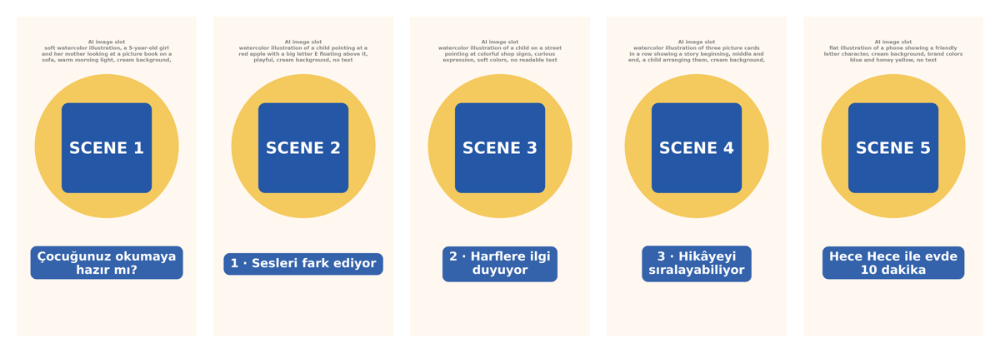

# AI Video Production Pipeline: Short-Form Vertical Video

**Service:** AI video creation · Reels / TikTok / YouTube Shorts · script → AI images → edit → subtitles · faceless explainer videos

**Client problem:** "We need 10 short videos a month for Instagram, consistent with our brand, without a film crew."

**How I work:** one `script.yaml` per video drives everything, so a series stays consistent and revisions are quick.

```
script.yaml ──▶ PRODUCTION_SHEET.md   (captions, Turkish voice-over, AI image prompts, camera motion)
            ──▶ storyboard.png        (client approves before anything is generated)
            ──▶ frames/scene_N.png    (AI images: Midjourney / Flux / DALL·E, 9:16)
            ──▶ reel.mp4              (1080×1920, Ken Burns motion, branded captions, fades)
            ──▶ subtitles_tr.srt      (for accessibility and platform upload)
```



| File | |
|---|---|
| [`script.yaml`](script.yaml) | Brand colours, format, voice spec and 5 scenes (caption, voice-over, image prompt, motion) |
| [`render.py`](render.py) | Builds the storyboard, branded caption overlays, per-scene motion (zoom/pan) with ffmpeg, the final MP4, SRT and production sheet |
| [`PRODUCTION_SHEET.md`](PRODUCTION_SHEET.md) | Hand-off sheet for the voice artist / AI tools |
| [`reel.mp4`](reel.mp4) | 17-second render (placeholder frames mark where the AI images go) |

**Placeholders by design:** the frames in this repo are layout placeholders that carry their own image prompt. For client work I generate the images with the client's chosen AI tool, drop them into `frames/`, add the voice-over (`--audio vo.mp3`), and re-render in one command.

```bash
pip install pillow pyyaml   # + ffmpeg
python render.py            # or: python render.py --audio voiceover.mp3
```

Other formats: 16:9 YouTube explainers, carousel posts from the same script, subtitle translation (TR ⇄ EN).
