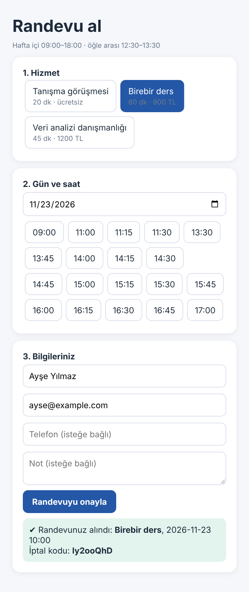

# Randevu: Full-Stack Appointment Booking App

**Service:** web application development · REST APIs · booking / form / admin systems for small businesses

**Client problem:** "Clients book by WhatsApp; we double-book, forget cancellations and can't see this week's income."



## Features
- **Customer page** (mobile-first, Turkish UI): choose service → day → free time slot → confirm; receives a cancellation code
- **Availability engine:** working hours, lunch break, weekends closed, 15-minute grid, past times hidden
- **No double booking:** overlap check inside a serialised database transaction; returns `409` if someone else took the slot a second earlier
- **Cancellation** by code frees the slot immediately
- **Admin API** (token-protected): bookings per day, totals, cancellation count, revenue
- Input validation (e-mail format, future dates, field lengths), parameterised SQL

## Stack
FastAPI · SQLite · Pydantic · vanilla HTML/CSS/JS (no build step) · pytest · Docker

```
app/main.py          API + availability logic
app/static/index.html  booking page
tests/test_api.py    7 tests: slots, lunch break, overlap, cancellation, weekend, validation, admin auth
Dockerfile
```

## Run
```bash
pip install -r requirements.txt
uvicorn app.main:app --reload          # http://localhost:8000  ·  API docs at /docs
pytest -q                              # 7 passed
docker build -t randevu . && docker run -p 8000:8000 -e ADMIN_TOKEN=secret randevu
```

**Next steps for a client version:** e-mail/SMS confirmation and reminders, Google Calendar sync, online payment (iyzico/Stripe), multi-staff calendars, PostgreSQL.
