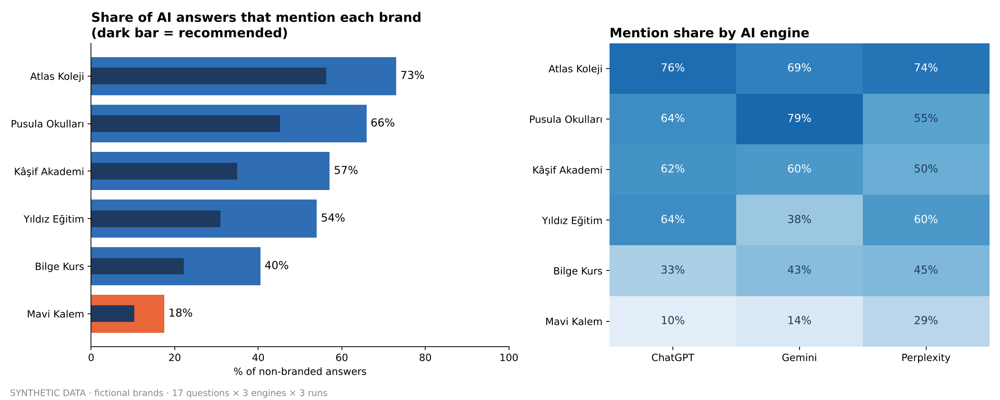

# AI Search Visibility (GEO) Benchmark

**Service:** Generative Engine Optimization (GEO / AEO) · AI visibility audits · share-of-voice measurement in AI answers

**Client question:** "When parents ask ChatGPT, Gemini or Perplexity for a good school or course, are we in the answer, and how do we compare with competitors?"

> ⚠️ **Demo with synthetic data and fictional brands.** The measurement pipeline is real; run it with `--live` and API keys to measure actual AI answers.

👉 **Client report: [`REPORT.md`](REPORT.md)**



## Method
| Step | What happens |
|---|---|
| **Question panel** | 17 Turkish questions in four intents: category ("best private primary schools in Ankara"), comparison, problem ("my child struggles with reading") and branded |
| **Multi-engine runs** | Each question on ChatGPT, Gemini and Perplexity, **3 repeated runs**, because AI answers vary |
| **Coding** | Every answer coded per brand: mentioned · recommended · position · own site cited |
| **Metrics** | Mention share, recommendation share, citation share, average position; **bootstrap 95% CIs**; answer stability across runs |
| **Diagnosis** | Gaps by engine and by question intent → prioritised actions |

Share-of-voice excludes branded questions, so a brand isn't credited for being found when someone already typed its name.

## Files
| File | |
|---|---|
| `geo_benchmark.py` | Question panel, engine runner (synthetic or live), answer coding, metrics, figure, report |
| `coded_answers.csv` | One row per answer × brand (918 rows) |
| `REPORT.md` | Client-style report with findings and recommendations |

```bash
pip install pandas numpy matplotlib tabulate
python geo_benchmark.py          # synthetic demo
python geo_benchmark.py --live   # real engines (add API calls in live_answer)
```
