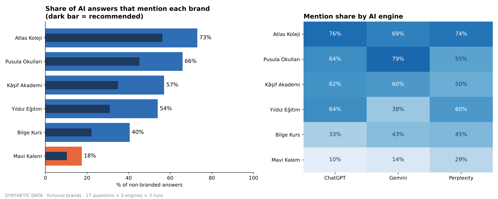

# AI Visibility Benchmark: Private Education (Türkiye) · SYNTHETIC DEMO

> **All data in this report is synthetic and all brand names are fictional.** The pipeline is real; with API keys
> (`--live`) the same code measures actual ChatGPT, Gemini and Perplexity answers.

**Client:** Mavi Kalem · **Competitors:** Atlas Koleji, Pusula Okulları, Kâşif Akademi, Yıldız Eğitim, Bilge Kurs
**Design:** 17 Turkish questions (category, comparison, problem, branded) × 3 engines × 3 repeated runs = 153 answers.
Share-of-voice metrics use the 14 non-branded questions only.

## Key findings
1. **Mavi Kalem ranks 6 of 6** on mention share (18%, 95% CI 11%–24%); the leader Atlas Koleji is mentioned in 73% of answers.
2. It is **recommended** in only 10% of answers, and its own site is cited in 11%.
3. Visibility differs by engine: strongest on **Perplexity** (29%), weakest on **ChatGPT** (10%).
4. The largest gap to the leader is in **category** questions.
5. Answers are not fully stable: for Mavi Kalem, 9% of question×engine results change between repeated runs, so audits should use repeated runs and confidence intervals rather than a single snapshot.

## Share of voice
| brand           |   mention_share |   recommendation_share |   citation_share |   avg_position | mention_ci   |
|:----------------|----------------:|-----------------------:|-----------------:|---------------:|:-------------|
| Atlas Koleji    |           0.73  |                  0.563 |            0.325 |          1.837 | 66%–80%      |
| Pusula Okulları |           0.659 |                  0.452 |            0.214 |          2.072 | 57%–74%      |
| Kâşif Akademi   |           0.571 |                  0.349 |            0.238 |          2.306 | 48%–65%      |
| Yıldız Eğitim   |           0.54  |                  0.31  |            0.198 |          2.221 | 45%–63%      |
| Bilge Kurs      |           0.405 |                  0.222 |            0.127 |          2.333 | 33%–49%      |
| Mavi Kalem      |           0.175 |                  0.103 |            0.111 |          2.318 | 11%–24%      |

## Recommendations
1. Publish answer-ready pages for **category** questions (clear claims, data, FAQ schema).
2. Earn mentions on the third-party sources ChatGPT cites most (parent forums, education guides, news).
3. Add Organization and Course schema; keep name, address and programmes consistent across directories.
4. Re-measure monthly with the same question panel; report changes with confidence intervals, not single runs.
