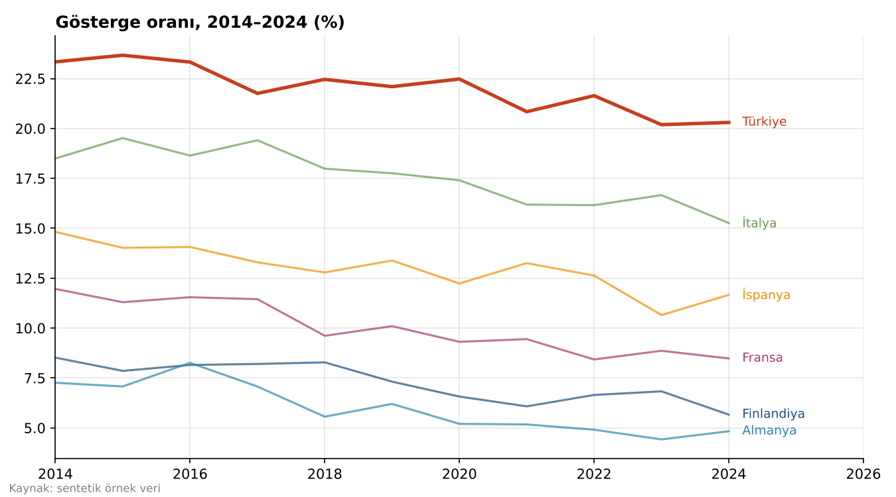
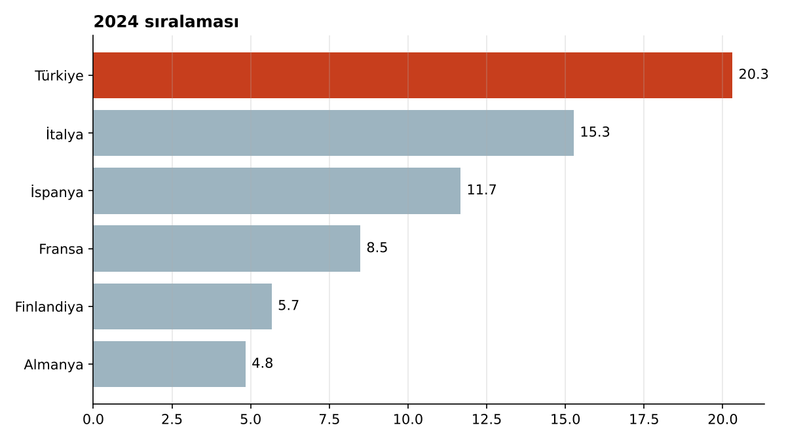
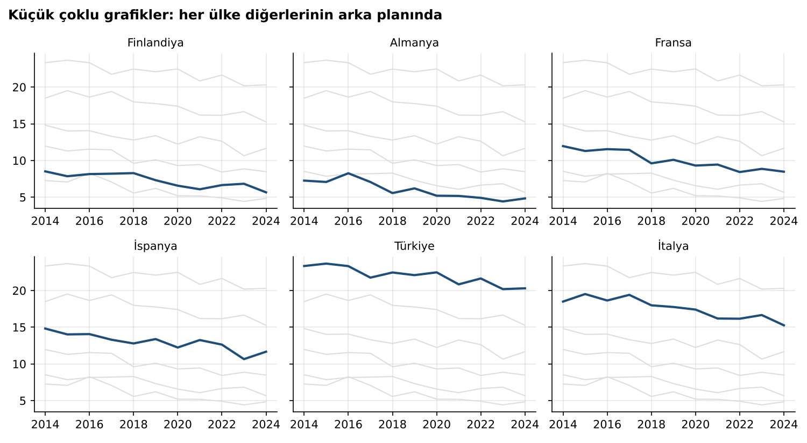
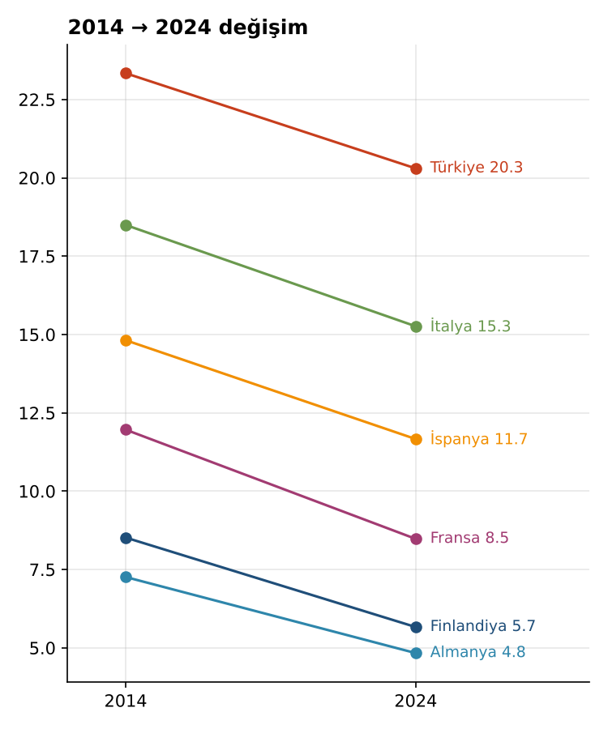

# 04 · Data Visualization & Infographic Charts

**Client problem:** "My report has the numbers but the charts look like 2005 Excel."

Four chart types from one dataset, each with a clear message, direct labels (no legend hunting), highlighted focus series and source line:

| | |
|---|---|
|  |  |
|  |  |

Tools: Python (matplotlib/plotly), Excel, Google Looker Studio, Power BI basics. Deliverables as PNG/SVG/PDF in your brand colours, or interactive HTML.
