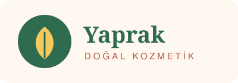
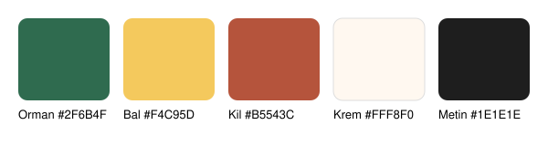
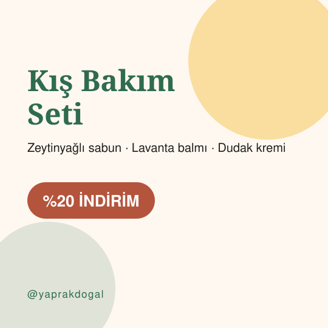
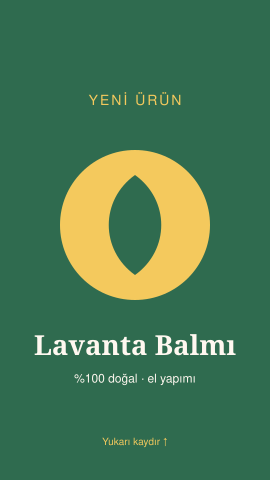
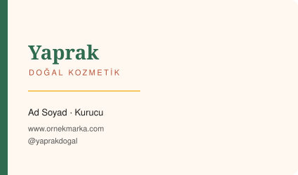

# 08 · Graphic Design: Brand Kit & Social Media Templates

**Client problem:** "I'm opening a small online shop. I need a logo, colours, and Instagram posts that look consistent."

**Fictional brand:** *Yaprak Doğal Kozmetik* (all assets are original and fully vector, editable SVG)

| Logo | Colour palette |
|---|---|
|  |  |

| Instagram post (1080×1080) | Story (1080×1920) | Business card |
|---|---|---|
|  |  |  |

**Brand rules:** Georgia (serif) for headlines, Helvetica/Arial for body; green leads, honey for highlights, clay only for calls-to-action.

Deliverables in SVG, PNG and PDF, plus **Canva templates** the client can edit themselves. Also offered: infographics for reports, presentation design, flyers, book/e-book covers, children's educational material.
