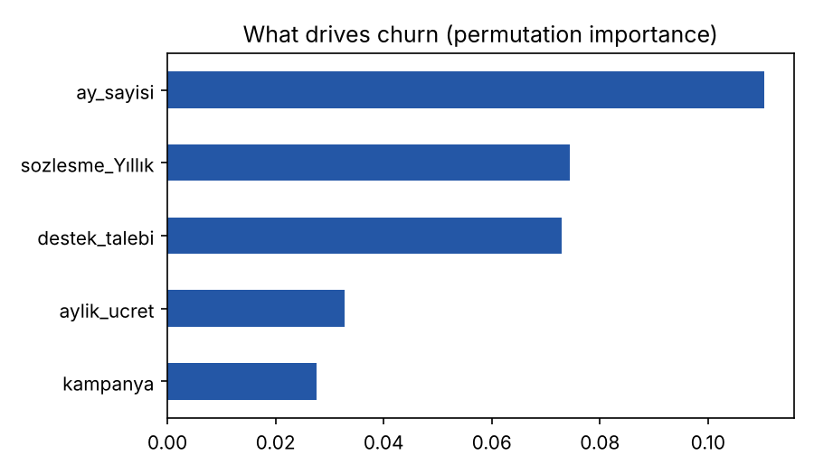

# 13 · Machine Learning: Prediction Models for Business

**Client problem:** "Which customers are about to leave, and why?"

`churn_model.py` (synthetic subscription data, n = 4,000):
- Stratified train/test split; **logistic regression baseline vs gradient boosting**
- ROC-AUC comparison, classification report
- **Permutation importance** chart: what actually drives churn
- `high_risk_customers.csv`: a ranked call list for the retention team, with **lift** explained in plain words

Other models I build: demand/sales forecasting, lead scoring, survey-based classification, text classification, and **fairness audits** of existing models.
